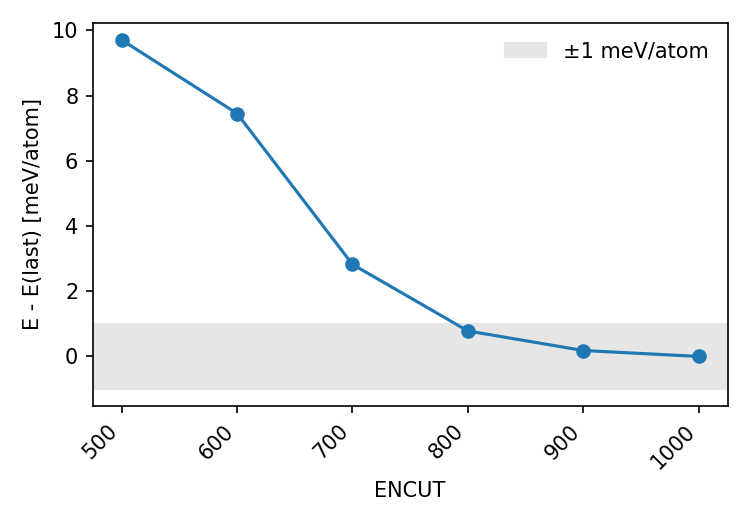
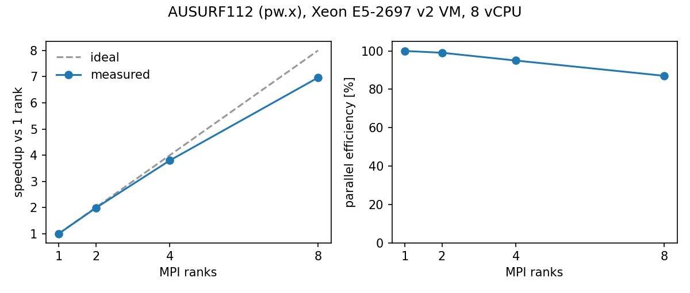

# dft-hpc-toolkit

[](https://github.com/eigen-ml/dft-hpc-toolkit/actions/workflows/tests.yml)

Small tools I use around VASP and Quantum ESPRESSO runs on Slurm clusters:

- Slurm job templates for VASP, pw.x and job arrays over a convergence scan
- convergence scans: one directory per cutoff or k-point mesh, then a table and plot of the results
- output parsers for VASP `OUTCAR` and pw.x output (final energy, SCF and relaxation status, Fermi level, magnetization, timing)
- `dfthpc watch` to follow the SCF of a running job
- a job chain for TRUBA (relax ISIF=3 → relax ISIF=2 → DFPT phonon) where a step starts only if the one before converged, with `dfthpc check`, `status`, `potcar`, `vacuum` and `supercell`
- an AUSURF112 scaling benchmark from an HPC internship
- notes on building QE, single-node Slurm and containers (Docker / Apptainer) on Rocky Linux 8

<p>
  
  
</p>

Left: a cutoff convergence test for graphene (VASP) made with `dfthpc summary`. Right: speedup of the AUSURF112 benchmark on 1–8 MPI ranks.

Pure Python standard library, so it runs on cluster login and compute nodes without installing anything else; the commands work with Python 3.6+ (installing with pip and the tests need 3.9+). Plotting is optional and needs matplotlib.

## Install

```bash
git clone https://github.com/eigen-ml/dft-hpc-toolkit.git
cd dft-hpc-toolkit
pip install --user .          # or: pip install --user ".[plot]"
```

Without pip, `PYTHONPATH=src python -m dfthpc ...` works the same way.

## Example: ENCUT convergence with VASP

```bash
# template/ holds INCAR, POSCAR, KPOINTS, POTCAR
dfthpc scan vasp template/ encut_scan ENCUT 400 450 500 550 600 700

# one Slurm array task per directory
sbatch --array=0-5 slurm/scan_array.sbatch encut_scan

# when the jobs are done
dfthpc summary encut_scan --tol 1 --csv encut.csv --plot encut.png
```

`summary` prints the energy per atom of each run, its difference to the most expensive setting (highest cutoff or densest mesh) in meV/atom, whether the SCF converged, and the first setting from which all later ones stay within the tolerance. Output for the graphene scan in the plot above (VASP 5.4.1):

```text
dir                value           E/atom [eV]    dE [meV/at]    scf  time [s]
ENCUT500           ENCUT500          -9.223424          9.705   True        35
ENCUT600           ENCUT600          -9.225680          7.448   True        42
ENCUT700           ENCUT700          -9.230307          2.822   True         3
ENCUT800           ENCUT800          -9.232348          0.781   True         3
ENCUT900           ENCUT900          -9.232947          0.181   True         5
ENCUT1000          ENCUT1000         -9.233129          0.000   True         8
Converged within 1 meV/atom from ENCUT800 on (relative to the last row).
```

Directories not created by `dfthpc scan` also work; they are ordered by the number or k-mesh in their names.

The same works for k-points (`dfthpc scan vasp template/ k_scan KPOINTS 6x6x1 9x9x1 12x12x1`, needs an automatic Gamma/Monkhorst-Pack `KPOINTS`) and for QE (`dfthpc scan qe pw.in ecut_scan ecutwfc 30 40 50 60`, keeps the `ecutrho/ecutwfc` ratio of the template unless `--no-keep-dual`; `kpoints` needs `K_POINTS automatic`).

## Parsing

```bash
dfthpc parse run1/OUTCAR run2/pw.out
```

```python
from dfthpc import parse_outcar, parse_pw_output

r = parse_outcar("OUTCAR")
r["energy_sigma0"], r["ionic_converged"], r["electronic_converged"], r["elapsed_s"]
```

VASP fields: version, cores (VASP 5 "total cores" or VASP 6 "mpi-ranks" line), NIONS, NKPTS, ISPIN, ENCUT, NELM, EDIFF, NSW, IBRION, ISIF, energy (TOTEN and sigma→0) of the last ionic step, energy per atom, number of ionic steps, SCF steps in the last ionic step, SCF loops that ended without reaching EDIFF (`nelm_hits`), E-fermi, magnetization (spin-polarized runs) and per-ion moments of the last `magnetization (x)` block (LORBIT), relaxation reached (None for runs without a relaxation target: NSW=0, IBRION=-1/0/5–8), SCF converged, finished, elapsed time, peak memory.

`electronic_converged` is True only if the last SCF loop printed "EDIFF is reached" **and** the OUTCAR ends with its timing block, so a job killed by the time limit in the middle of an SCF loop does not count as converged. In DFPT runs (IBRION=7/8) the linear-response loops count as SCF loops too. `dfthpc summary` leaves runs whose SCF did not converge out of the comparison.

pw.x fields: version, calculation type (scf / relax / nscf-bands), atoms, ecutwfc, k-points, last `!` total energy in Ry and eV, number of SCF cycles, iterations of the last one, SCF converged, Fermi energy (or highest occupied level; spin up/down Fermi energies when printed), total magnetization, BFGS converged, finished (`JOB DONE`), wall time.

## Watching a job

```bash
dfthpc watch run_dir/            # VASP: reads OSZICAR (and NELM from INCAR)
dfthpc watch pw.out -f           # pw.x output, refresh every 30 s
```

```text
 ionic   scf scf acc. [Ry]        energy [Ry]      mag
     1    15      7.00e-09       -43.12301771        -
     2     9      1.30e-09       -43.08067584        -
     3    10      1.60e-09       -43.12635026        -
     4     6      8.00e-10       -43.12647146        -
     5     8      7.00e-11       -43.12647356        -
```

(Output for the `relax-el` reference run of the QE test suite.) For VASP the column is the last `dE` of each SCF loop in eV and the magnetization from `OSZICAR`; a step whose SCF count reached NELM is marked, since its energy is not converged.

## Slurm templates

| File | Use |
| --- | --- |
| `slurm/vasp.sbatch` | one VASP run in the submit directory |
| `slurm/qe_pw.sbatch` | one pw.x run (`pw.in` → `pw.out`), fails if `JOB DONE` is missing |
| `slurm/scan_array.sbatch` | array job over the directories in `SCAN/dirs.txt`, VASP or QE detected per directory |
| `slurm/truba_vasp.sbatch` | one VASP 6 step on TRUBA, ends with `dfthpc check` (see [TRUBA chain](#truba-chain)) |
| `slurm/submit_chain.sh` | submits the three steps of one candidate with `--dependency=afterok` |

Edit the `#SBATCH` lines for your cluster. The program and environment are set by variables (`VASP_CMD`, `VASP_ENV`, `PW_CMD`, `QE_ENV`) so they can be changed without editing the script, e.g. `sbatch --export=ALL,VASP_ENV="module load vasp/6.4" slurm/vasp.sbatch`. The VASP defaults come from the scripts I used on our university cluster (VASP 5.4.1 built with Intel 2017 compilers and MPI).

## TRUBA chain

For the DFT checks of 2D magnetic candidates on TRUBA (`arf` cluster, VASP 6.6.0 built with Intel oneAPI MPI). A candidate directory holds three steps, each with `INCAR`, `KPOINTS` and `POTCAR` (the first also `POSCAR`):

```text
CrI3/1_relax_isif3 → CrI3/2_relax_isif2 → CrI3/3_phonon (4x4x1 supercell, IBRION=8, for phonopy)
```

```bash
# on arf-ui, under /arf/scratch (jobs cannot be submitted from /arf/home); no pip needed
cd /arf/scratch/$USER && git clone https://github.com/eigen-ml/dft-hpc-toolkit.git
alias dfthpc="PYTHONPATH=/arf/scratch/$USER/dft-hpc-toolkit/src python3 -m dfthpc"
dfthpc potcar CrI3/1_relax_isif3/POSCAR --root /arf/scratch/$USER/pseudoPOT/PP_GGA   # TITELs, largest ENMAX

PARTITION=debug dft-hpc-toolkit/slurm/submit_chain.sh CrI3       # dry run first: 4 cores, 4 h
PHONON_PARTITION=orfoz dft-hpc-toolkit/slurm/submit_chain.sh CrI3   # relax on hamsi (56), phonon on orfoz (112)
dfthpc status CrI3
```

Each job (`slurm/truba_vasp.sbatch`):

- loads `comp/oneapi/2024` and `lib/hdf5/1.14.3-oneapi-2024` and **no Open MPI module** (two MPI libraries in one job crash or run slow), sets `ulimit -s/-l unlimited` and `OMP_NUM_THREADS=1`, and runs `mpirun -np $SLURM_NTASKS` with one rank per core (`-N 1 -n <cores> -c 1`, 3-day limit);
- takes the `CONTCAR` of the step before as `POSCAR`; the phonon step writes the supercell of it in phonopy's `SPOSCAR` order (`dfthpc supercell`, checked against phonopy) and expands `MAGMOM`, keeping `POSCAR-unitcell` for `phonopy --fc vasprun.xml`;
- writes `STOPCAR` (`LSTOP = .TRUE.`) 15 minutes before the time limit, so a relaxation stops after an ionic step with a usable `CONTCAR`; go on with `submit_chain.sh --from N --resume`;
- ends with `dfthpc check`: SCF converged, relaxation reached (not asked of the DFPT step, where every linear-response loop must converge instead), and after ISIF=3 at least 20 Å of vacuum (ISIF=3 also shrinks the vacuum). A failed check exits with 3 and Slurm cancels the rest of the chain;
- writes `status/<jobid>.csv` (one file per job, since file locks are not reliable on Weka): time, job, step, directory, exit code, SCF / relaxation reached, energy, total and per-ion moments, time and core-hours;
- with `CLEAN=1` deletes `WAVECAR`, `CHG`, `CHGCAR` and `WAVEDER` after a passing check (`/arf` allows 500 000 files and 2 TB).

Python on TRUBA: the job calls `python3 -m dfthpc` from the clone with the standard library only, which works on Python 3.6 or newer (checked with vermin; the output is ASCII, so a C locale is fine). Which `python3` the compute nodes have is not checked yet: run `python3 --version` in the dry run, or set `PYTHON_MODULE` to a module from `module avail python`; it is loaded for the `dfthpc` calls only, never for VASP. The scripts have not run on TRUBA yet; the first run is the dry run on the `debug` queue with cheap inputs (low ENCUT, small k-mesh, a few NSW).

## What is tested

- Parsers: unit tests on short OUTCAR and pw.x excerpts (`tests/data/`; line formats copied from real output, numbers made up). The VASP 6 excerpts are synthetic (`*_synthetic`): a relaxation killed in the middle of an SCF loop, one that used up NSW, a DFPT run and an AFM run with per-ion moments; their loop layout was compared with public VASP 6.3 / 6.4 OUTCARs. Outside CI, the VASP parser was run on 109 OUTCARs from my own calculations: final energies match `OSZICAR` to its printed precision and ionic step counts match for all 105 runs that have an `OSZICAR`. The pw.x parser was checked against 12 reference outputs from the Quantum ESPRESSO test suite (scf, lsda, relax, bands). Those files are not included here.
- Scans, summary and watch: unit tests on generated directories and short excerpts.
- Slurm templates: `bash -n` and shellcheck, and CI runs them with bash using a fake command in place of VASP/pw.x (checks directory selection, input checks and the `JOB DONE` check). The TRUBA chain runs with a fake `sbatch` that starts each job at once and cancels it when its `afterok` dependency failed: CONTCAR hand-over, supercell, status rows, `STOPCAR` on USR1, and that the chain stops after an unconverged step. CI does not have Slurm, VASP or QE, so real submissions are not tested there.

```bash
pip install ".[test]"
pytest
```

## Benchmark

[`benchmarks/ausurf112`](benchmarks/ausurf112): the AUSURF112 QE benchmark on an 8-vCPU Xeon E5-2697 v2 virtual machine, 1 to 8 MPI ranks. Speedup 6.96 on 8 ranks (87% parallel efficiency), with notes on what limited it.

## Notes

- [Single-node Slurm on Rocky Linux 8](docs/slurm-single-node-rocky8.md)
- [Building Quantum ESPRESSO 7.4.1 on Rocky Linux 8](docs/qe-build-rocky8.md) ([Türkçe](docs/tr/qe-derleme-rocky8.md))
- [Conda, Docker and Apptainer on Rocky Linux 8](docs/containers-apptainer.md)

These come from documentation I wrote during an HPC internship in 2025.

## License

MIT. VASP and its POTCAR files are licensed separately; never commit POTCARs (they are in `.gitignore`).
